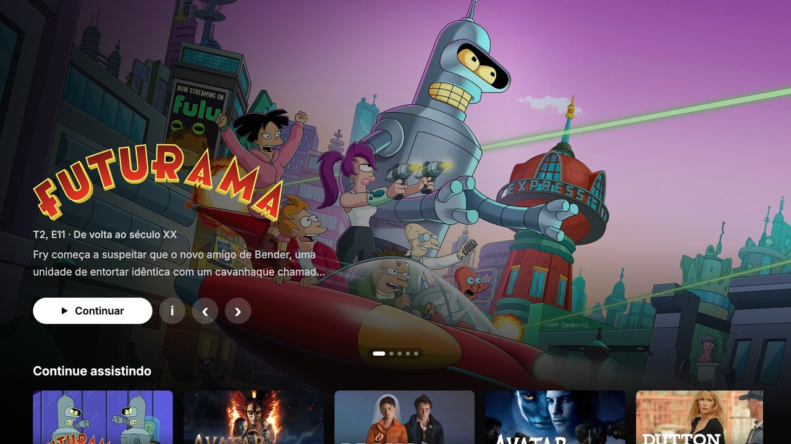
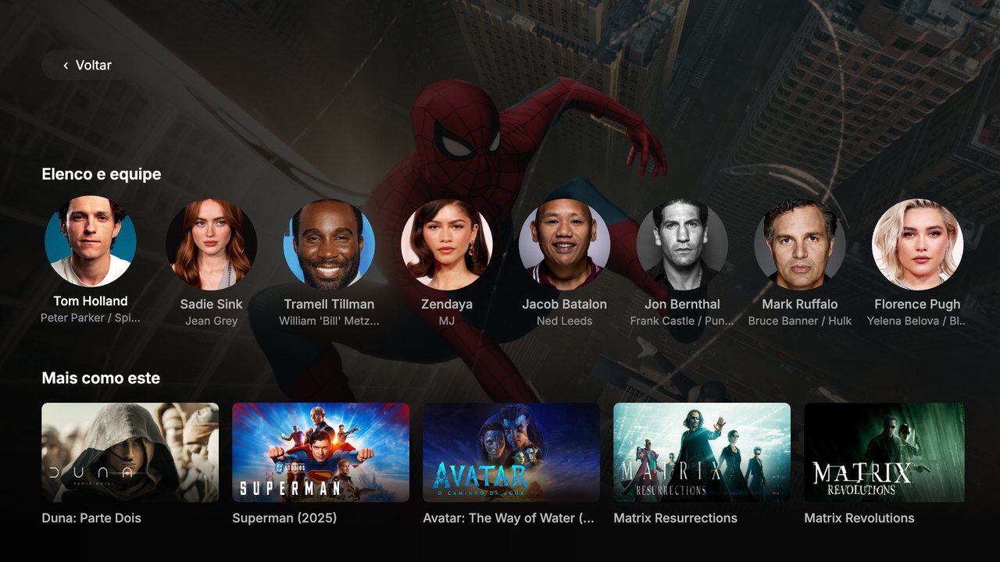
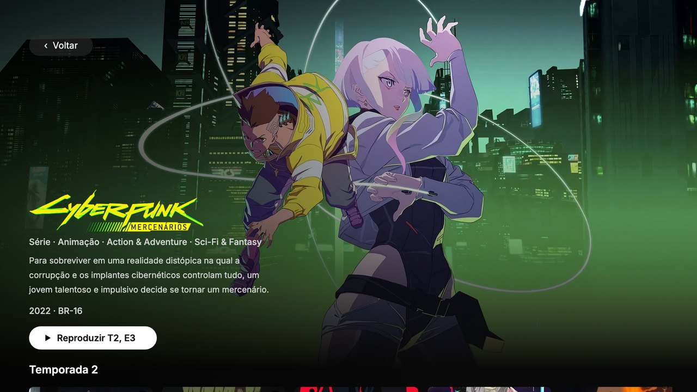
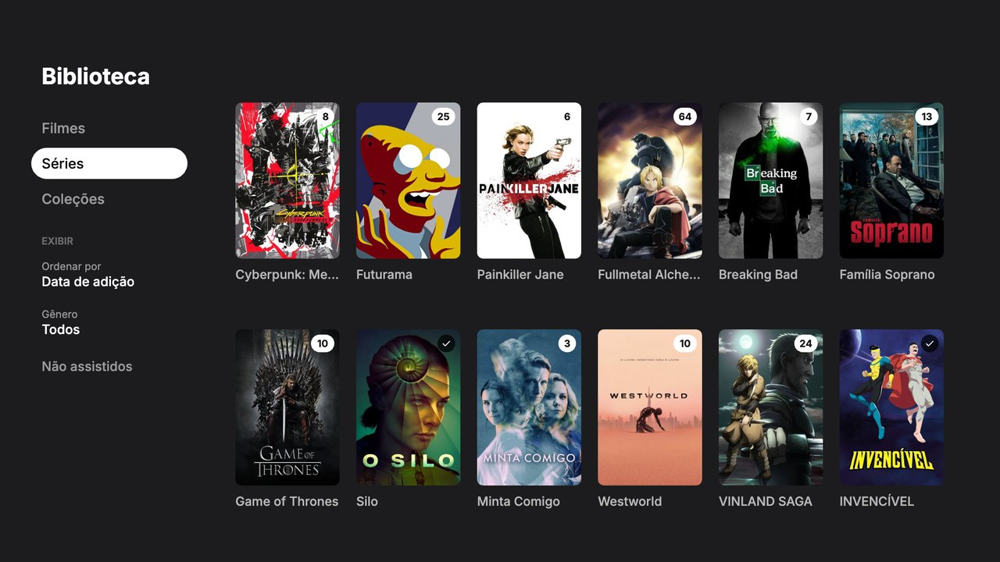

<div align="center">


<p>
  <a href="https://github.com/jravolio/luma-roku/actions/workflows/ci.yml"></a>
  <a href="LICENSE"></a>
  
  
  
  <a href="#-contributing"></a>
</p>

<p><a href="#-features">Features</a> · <a href="#-install-on-your-roku">Install</a> · <a href="#-recommended-server-setup">Server setup</a> · <a href="#-build-from-source">Build</a> · <a href="#-faq">FAQ</a></p>

</div>

<br>

<p align="center">
  
</p>

Luma is a native Roku channel for your own [Jellyfin](https://jellyfin.org) library. It brings the Apple TV app's look and feel to Roku TVs: full-bleed artwork, title logos, quiet animations and one-press playback. Picture and sound quality come first: if the TV can play a file as-is, Luma never converts it.

> [!NOTE]
> The interface is in **Brazilian Portuguese** for now. Translations are welcome.

## ✨ Features

- 🍿 **Apple TV-style Home**: a featured carousel with title logos, Continue Watching, Recently Added, title art on every tile, watched checkmarks and unwatched-episode counts.
- 🎬 **Rich title pages**: seasons, the next episode to watch, **Cast & Crew** with portraits, **More Like This**, and pages for each actor.
- 📚 **Library that's easy to browse**: movies, shows and collections, sorted by date added, A–Z or release year, filtered by genre or unwatched.
- ⏭️ **Skip intro, recap and credits** with one press, from Jellyfin's media segments (the Intro Skipper plugin).
- ▶️ **Up Next**: the next episode's card counts down during the credits, and Luma checks you're still watching after three episodes in a row.
- 🎧 **Remembers your audio and subtitle choice** for each series, so every episode starts the way you like.
- 🖼️ **Scrub previews**: thumbnails above the timeline from Jellyfin's trickplay images. Holding the remote keeps speeding up, faster on long films.
- 🎞️ **Quality first**: direct play whenever the TV can, including 4K HEVC and Dolby Digital / Dolby Digital Plus passthrough when the TV reports support. Audio, subtitle, quality, version and chapter menus.
- 🔐 **Sign in once**: Luma finds your server on the network and keeps your login, even when the server's IP address changes. The server administrator can switch between profiles.
- 🌙 **Ambient mode**: after a few idle minutes your library's artwork fills the screen, with the time and date.
- ⚡ **Fast**: Home opens from a local cache while the server is checked, requests are batched and compressed, and pages load ahead of time while a title is in focus.

## 📸 Screenshots

<table>
  <tr>
    <td width="50%" align="center"><br><sub>Cast &amp; Crew and More Like This</sub></td>
    <td width="50%" align="center"><br><sub>Show page with the next episode</sub></td>
  </tr>
  <tr>
    <td width="50%" align="center"><br><sub>Library with sorting and filters</sub></td>
    <td width="50%" align="center"><br><sub>Ambient mode</sub></td>
  </tr>
</table>

## 📺 Install on your Roku

Luma isn't in the Roku Channel Store; you install it yourself with Roku's developer mode. It takes about five minutes, once.

**1. Turn on developer mode.** On the TV's Home screen press **Home ×3, Up ×2, Right, Left, Right, Left, Right** on the remote. Note the address shown (like `http://192.168.1.60`), choose **Enable installer and restart**, accept the agreement and set a password. The username is always `rokudev`.

**2. Get the app.** Download `luma.zip` from the [latest release](https://github.com/jravolio/luma-roku/releases/latest), or [build it yourself](#-build-from-source).

**3. Install it.** Open the TV's address in a browser on the same network, sign in as `rokudev`, choose `luma.zip` and press **Install**. Or from a terminal:

```sh
curl --digest -u rokudev:YOUR_PASSWORD \
  -F mysubmit=Install -F archive=@luma.zip \
  http://YOUR_ROKU_IP/plugin_install
```

**4. Sign in.** Luma opens, finds your Jellyfin server on the network and asks for your username and password once.

> [!TIP]
> The channel stays on your Home screen until you install another developer channel or turn developer mode off. To update Luma, install the new `luma.zip` the same way; your login is kept.

## 🧩 Recommended server setup

Luma works with a plain Jellyfin server. A few server features make it better:

<details>
<summary><b>Skip intro and credits</b></summary>

Install the [Intro Skipper](https://github.com/intro-skipper/intro-skipper) plugin. Luma reads intro, recap and credits markers through Jellyfin's media segments, and falls back to chapters named *Intro* or *Credits*.
</details>

<details>
<summary><b>Scrub previews (trickplay)</b></summary>

In Jellyfin's dashboard, enable trickplay image extraction for your libraries, then run **Generate Trickplay Images** under Scheduled Tasks. Under **Playback → Trickplay**, a **5×5** tile grid is recommended: each sheet is then 1600×900, which a Roku decodes at full size. Expect about 3–4 MB per hour of video at the default 320 px width.
</details>

<details>
<summary><b>Collections</b></summary>

Turn on automatic collections in your Movies library settings, or create collections in Jellyfin. They appear under **Coleções** in the library.
</details>

## 🔨 Build from source

You need **Node.js 24+** and **Python 3**.

```sh
git clone https://github.com/jravolio/luma-roku.git
cd luma-roku
npm ci
npm run build:roku        # → dist/luma.zip
```

Then install `dist/luma.zip` as in [step 3](#-install-on-your-roku).

<details>
<summary><b>Run it without a TV (macOS)</b></summary>

```sh
npm run simulate:roku
```

This downloads the [BrightScript Desktop Simulator](https://github.com/lvcabral/brs-desktop) on first run, then loads the same `dist/luma.zip` the TV uses. Open **http://127.0.0.1:8090/** for the screen and an on-screen remote. See the [simulator guide](docs/roku-simulator.md).
</details>

<details>
<summary><b>Browser preview</b></summary>

A React version of the interface, useful for quick design work, with a local gateway to your server and an optional demo library of open films:

```sh
npm --prefix preview ci
npm run dev               # http://127.0.0.1:5173
```
</details>

## 🧪 Tests

```sh
npm test                  # BrightScript specs (run under the brs interpreter) and gateway tests
npm --prefix preview test # browser preview
```

[`tests/roku/HARDWARE.md`](tests/roku/HARDWARE.md) is the checklist for what only a real TV can show (decoding, HDR, memory, the remote).

## 🧭 Project layout

| Path | What's there |
| --- | --- |
| [`roku/`](roku) | The Roku channel: BrightScript and SceneGraph |
| [`preview/`](preview) | Browser preview of the interface (React) |
| [`server/`](server) | Local discovery, sign-in and media gateway for the preview |
| [`tests/`](tests) | Automated tests and the hardware checklist |
| [`scripts/`](scripts) | Build, simulator, brand art and diagnostics |
| [`docs/`](docs) | [Architecture](docs/architecture.md), [testing](docs/testing.md), [performance](docs/performance-and-quality.md) and [verification notes](docs/verification.md) |

## ❓ FAQ

<details>
<summary><b>Luma doesn't find my server.</b></summary>

Discovery uses Jellyfin's local broadcast on port 7359, which some routers and VPNs block. Open **Ajustes** (the ✱ button) → **Informar endereço do servidor** and type the address shown in Jellyfin's dashboard, like `http://192.168.1.50:8096`.
</details>

<details>
<summary><b>Does it transcode?</b></summary>

Only when the TV can't play a file as it is. Luma asks the TV which video and audio formats it can decode, and prefers the original file. You can also pick a quality limit from the player's menu.
</details>

<details>
<summary><b>Which TVs is it tested on?</b></summary>

A Philco Roku TV (G510X hardware) on Roku OS 16, with Jellyfin 12.2. Other Roku devices running a recent Roku OS should work. Reports are welcome.
</details>

## 🤝 Contributing

Issues and pull requests are welcome. Please run `npm test` before opening a PR, and say what you checked on a real Roku if your change affects playback or the remote.

## 📄 License

[MIT](LICENSE): use it, change it, share it.

## 🙏 Credits

- [Jellyfin](https://jellyfin.org), and the [official Jellyfin Roku client](https://github.com/jellyfin/jellyfin-roku) for showing the way on the platform.
- [BrighterScript](https://github.com/rokucommunity/brighterscript) for the build, [brs](https://github.com/sjbarag/brs) for running the BrightScript tests, and the [BrightScript Desktop Simulator](https://github.com/lvcabral/brs-desktop).
- Fonts: [Inter](https://rsms.me/inter/), [Fraunces](https://fonts.google.com/specimen/Fraunces), [Hanken Grotesk](https://fonts.google.com/specimen/Hanken+Grotesk) and [Instrument Serif](https://fonts.google.com/specimen/Instrument+Serif), under the SIL Open Font License (included next to each font).
- The preview's demo library uses Blender Foundation open films; see [preview/CREDITS.md](preview/CREDITS.md).

<sub>Luma is an independent project, not affiliated with Jellyfin, Roku or Apple. Apple TV is a trademark of Apple Inc.; Roku is a trademark of Roku, Inc.</sub>
